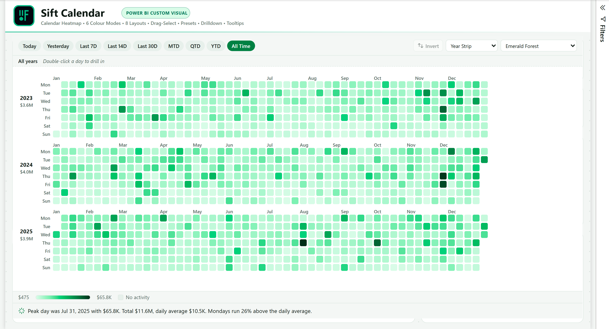

# Sift Calendar

**A calendar heatmap custom visual for Power BI.** Eight layouts, six ways to colour a day, fiscal / retail / Hijri calendars, drag-to-select date ranges that filter the whole report, and one plain-English sentence under the calendar that tells you what the data found.

- **No privileges requested.** The visual makes no network calls and downloads nothing. Your data never leaves the report.
- **No dependencies at runtime** beyond Microsoft's Power BI visual libraries.
- **MIT licensed.**

---

## Contents

- [What's in this repo](#whats-in-this-repo)
- [Quick start](#quick-start)
- [Fields (data roles)](#fields-data-roles)
- [Layouts](#layouts)
- [Colour modes](#colour-modes)
- [Calendars](#calendars)
- [Interactions](#interactions)
- [Format pane reference](#format-pane-reference)
- [Accessibility](#accessibility)
- [Performance and limits](#performance-and-limits)
- [Security and privacy](#security-and-privacy)
- [Known limitations](#known-limitations)
- [License](#license)

---

## What's in this repo

| Path | What it is |
| --- | --- |
| `release/SiftCalendar.pbiviz` | The packaged visual. Import it into any report. |
| `SiftCalendar.pbip` | A complete sample report in Power BI Project (PBIP) format, with the visual already embedded. |
| `SiftCalendar.Report/` | Report definition (PBIR): page, visual configuration, theme, embedded visual. |
| `SiftCalendar.SemanticModel/` | Semantic model (TMDL): Sales, Dates, Customers, Products, Channels, measures. Sample data is inline, so the report opens and refreshes with no data source to configure. |
| `docs/` | Screenshots. |

The sample data is synthetic: three years (2023-2025) of orders for fictional companies and products.

## Quick start

### Option A - open the sample report

1. Install a recent **Power BI Desktop** (PBIP support is on by default in current versions).
2. Clone or download this repository.
3. Open `SiftCalendar.pbip`.

The page *Executive Calendar Heatmap* shows the visual bound to Revenue, Target, Budget, Prior-year Revenue, Hour and Holiday.

### Option B - use the visual in your own report

1. In Power BI Desktop: **Visualizations pane → `...` → Import a visual from a file**.
2. Pick `release/SiftCalendar.pbiviz`.
3. Add the **Sift Calendar** visual to a page and drop in at least a **Date** and a **Value**.

> Use a real date column (a Date table is ideal). Each row is treated as one day; several rows on the same date are summed.

## Fields (data roles)

| Field | Required | Purpose |
| --- | --- | --- |
| **Date** | Yes | Date or DateTime column. One cell per day. |
| **Value** | Yes | The measure that drives colour and the caption. |
| Hour | | Hour of day (0-23). Enables the *Weekday x hour* layout and drilling into a single day's hours. |
| Target | | Enables *On target* colouring and attainment % in the tooltip. |
| Budget | | Enables *Vs budget* colouring. |
| Compare to | | A prior-period measure (e.g. same day last year). Enables *Vs last year* colouring and YoY %. |
| Holidays | | Holiday name per date, shown as a badge in the tooltip. |
| Event label | | Event name per date. Adds a marker on the day and the name in the tooltip. |
| Category | | Splits *Small multiples* into one calendar per category. |
| Sort by | | Orders the Small multiples calendars (highest first). |
| Cell colour | | A measure returning a hex colour (`#RRGGBB`) to override a day's colour. |
| Tooltips | | Extra measures to list in the tooltip. Also passed to report-page tooltips. |

Dates that are missing from the data still get a cell (shown as empty), so gaps are visible instead of silently collapsing the calendar.

## Layouts

Switch from the dropdown in the visual's toolbar or under **Format → Calendar Layout → Layout Shape**. The toolbar choice is saved with the report.

| Layout | Shows |
| --- | --- |
| **Year strip** | A continuous, GitHub-style strip: weeks as columns, weekdays as rows. When several years would shrink cells too far, it stacks one row per year automatically. |
| **Month blocks** | One small wall-calendar card per month, with day numbers and the month total. |
| **Months x days** | One row per month, one column per day of the month. Good for spotting month-end effects. |
| **Year over year** | One strip per year, aligned from the start of each year so the same week lines up vertically. Year totals on the left. |
| **Weekday cycle** | Average per weekday for each month. Click a cell to select every matching day (e.g. all Fridays in March). |
| **Weekday x hour** | 7 x 24 average-per-hour grid. Needs the Hour field. |
| **Small multiples** | One mini strip per Category value, sharing one colour scale. Without a Category it shows one strip per year. |
| **Race** | Plays the calendar forward day by day. Play / pause, or scrub with the slider. |

Cells auto-fit the visual's size. Turn **Auto-fit Cells to Visual** off to use a fixed cell size.

## Colour modes

**Format → Colour & Meaning → Colour Shows**

| Mode | A day is coloured by | Needs |
| --- | --- | --- |
| **Amount** | A continuous gradient from low to high. | Value |
| **Unusual days** | Highlighted when it falls outside the normal range *for its own weekday* (Tukey IQR fences; 8+ weeks per weekday, otherwise all days). | Value |
| **In bands** | Five discrete steps between the lowest and highest day. | Value |
| **Vs last year** | Met colour when at or above the comparison, miss colour when below. | Compare to |
| **On target** | Met (100%+), close (85-99%), or missed (under 85%). | Target |
| **Vs budget** | At or above budget vs below. | Budget |

Under the calendar, **one sentence names the finding**, for example *"Peak day was Jul 31, 2025 with $65.8K. Total $11.6M, daily average $10.5K. Mondays run 26% above the daily average."* The sentence changes with the colour mode. A compact **legend** shows what the colours mean (it can be turned off).

**Themes:** Emerald, Sapphire, Sunset, Cyberpunk, Midnight (dark), Monochrome, High Contrast, and a **colour-blind-safe** Viridis theme. Pick one in the toolbar or the Format pane. You can also set your own primary heat colour, met / miss / outlier / empty colours, and an optional **texture** (dots or hatching, denser for higher values) so magnitude reads without relying on colour.

## Calendars

**Format → Calendar Layout**

- **Week starts** on Monday, Sunday or Saturday.
- **Fiscal year** starts in any month. QTD and YTD presets, quarters and drilldown follow it.
- **Fiscal year label**: `2024` (calendar years), `FY25` (end year), `FY24` (start year) or `FY24/25` (both).
- **Retail calendars**: 4-4-5, 4-5-4 and 5-4-4. The year starts on the week-start day closest to the 1st of the fiscal start month; a 53rd week goes into the last period.
- **Hijri (Umm al-Qura)** and **Solar Hijri (Persian)**, using the browser's built-in calendar support. Months, years and labels (`1446 AH`, `1403 SH`) follow the chosen calendar.

## Interactions

| Action | Result |
| --- | --- |
| Click a day | Filters the report to that day. Click it again to clear. |
| Ctrl / Cmd + click | Add or remove days. |
| Shift + click | Select every day between the last clicked day and this one. |
| Click and drag | Select a date range. |
| Preset buttons | Today, Yesterday, Last 7 / 14 / 30 days, MTD, QTD, YTD, All time. Relative to the latest date in the data. |
| **Invert** | Turns the selection into "every day *except* these". |
| Double-click a day | Drill in: All years → Year → Quarter → Month → that day's hours. Use the breadcrumb or **Back** to climb out. |
| Right-click | Power BI's own context menu (drill through, show as table, include / exclude). |
| Click empty space | Clears the selection (can be turned off). |

**A contiguous selection is sent as one date-range filter** ("is on or after X and before Y"), so the filter pane reads cleanly and the filter is saved with bookmarks. Non-contiguous selections are sent as a list of dates. Selections made elsewhere (filter pane, bookmarks, sync slicers) are reflected back in the calendar.

**Tooltips:** a built-in hover card (date, value, target and attainment, budget, last year and YoY %, extra tooltip measures, holiday, event, unusual-day badge), or switch **Tooltip Type** to *Power BI tooltip* to use Power BI's default tooltip or a **report-page tooltip**.

## Format pane reference

| Card | Settings |
| --- | --- |
| **Calendar Layout** | Layout shape, week start, fiscal year start, calendar system, fiscal year label, cell style (regular / pill), auto-fit, cell size, corner radius, gap, weekday and month labels, event markers |
| **Colour & Meaning** | Colour mode, theme, texture, auto-contrast text, primary heat / met / miss / outlier / empty colours |
| **Interactions & Presets** | Drag select, preset buttons, Invert button, click empty space to clear |
| **Drilldown & Hierarchy** | Enable drilldown, breadcrumb, starting granularity (year / quarter / month / day / hour, anchored on the latest date) |
| **Plain-Words Insight Caption** | Show sentence, show legend, font size, text colour |
| **Number Format** | Display units (Auto, none, K, M, B, Lakhs / Crores with Indian digit grouping, 万 / 億), decimals, unit on every value or once in the caption, negative style (`-1,234`, `(1,234)`, `1,234-`, red), currency symbol override |
| **Tooltip Settings** | Tooltip type (hover card or Power BI), show tooltip, text for empty days, YoY variance, target, holiday |

Values pick up the currency symbol and percent format from the measure's own format string.

## Accessibility

- **Keyboard:** focus the calendar with Tab. Arrow keys move between days, Enter / Space selects, Shift + Enter extends, Ctrl + Enter adds, Escape clears.
- **Screen readers:** every day carries a label with its date and value.
- **Windows high-contrast mode:** the visual switches its chrome to the system colours, outlines every cell, and keeps the day colours so the data still reads.
- **Contrast:** day numbers switch between dark and light ink per cell to keep WCAG AA contrast.
- **Colour-blind-safe** theme and optional **texture** for magnitude.

## Performance and limits

- Up to **30,000 rows** per query. If Power BI truncates the data, the caption says so.
- Cells are drawn once per data or layout change. Selecting, hovering, dragging and race playback only update existing cells, so interaction stays smooth on multi-year calendars.
- Rapid clicks are debounced before the filter is sent to the report.

## Security and privacy

- `"privileges": []` - the visual requests **no** web access, local storage or file export permissions.
- No network requests, no telemetry, no external fonts or scripts.
- All text from your data (holiday names, event labels, categories) is written with `textContent`, never as HTML.
- The sample model has no external data source; data is inline in the TMDL.

See [SECURITY.md](SECURITY.md) to report an issue.

## Known limitations

- Hijri month names come from the browser's English locale data.
- The visual is not certified and is not on AppSource.
- Localisation (non-English UI strings) is not implemented yet.
- This repository ships the packaged visual and the sample report, not the TypeScript source.

## License

[MIT](LICENSE). Third-party components bundled in the visual are listed in [THIRD_PARTY_NOTICES.md](THIRD_PARTY_NOTICES.md).

Power BI is a trademark of Microsoft Corporation. This project is independent and is not affiliated with or endorsed by Microsoft. All company, customer and product names in the sample data are fictional.

---

Built by [faizaan.me](https://faizaan.me).
